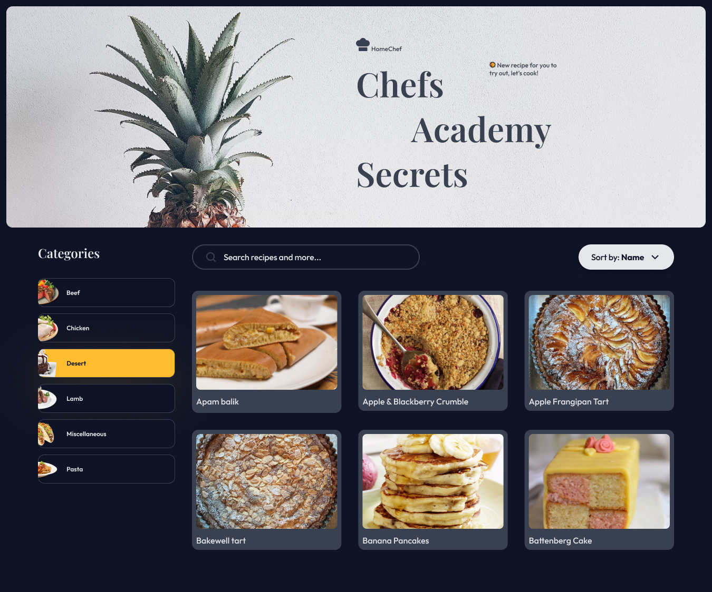

# Recipe Finder

A responsive recipe finder web application built with React and Tailwind CSS.

Users can explore recipes by category, search for recipes, sort recipes by ID, and view detailed recipe information, including ingredients and cooking instructions. The project focuses on practicing React concepts while building a real-world style recipe application.

## Project Type

React Recipe Finder & Search Application

**Live Link:**  [Live Link:](https://recipe-finder-deventest.netlify.app/categories)

## Preview

## Features

- Fetch recipe categories from an external API
- Display recipes dynamically based on the selected category
- Search recipes by name, area, recipe ID, and cooking instructions
- Sort recipes by ID
- View detailed information about individual recipes
- Display recipe images, names, categories, and areas
- Show ingredients and cooking instructions on the details page
- Navigate between the categories page and recipe details page
- Display skeleton loading placeholders while data is loading
- Show a message when no matching recipes are found
- Handle unknown routes with a custom 404 page
- Responsive layout for different screen sizes
- Clean and modern UI using Tailwind CSS

## Technologies Used

- React
- JavaScript (ES6+)
- Tailwind CSS
- Vite
- Axios
- React Router DOM
- TheMealDB API

## React Concepts Used

### useState

Used `useState` to manage application states such as:

- Recipe categories
- Selected recipe category
- Recipe data
- Search input
- Sorting option
- Recipe details
- Loading state
- Search state

### useEffect

Used `useEffect` to fetch data from the API and update the application when the selected category or recipe data changes.

It is also used to fetch the details of a selected recipe based on its ID.

### Context API

Used React Context API to share recipe data and related functions across multiple components.

The `RecipeContext` provides shared access to categories, recipes, search input, sorting options, and other application states without passing every value through multiple component levels.

### useContext

Used `useContext` to access shared recipe data and functions inside components such as `Categories`, `Search`, and `RecipeContent`.

### Props

Props are used to pass data between components.

For example:

- Recipe information is passed to the `RecipeInfo` component
- Recipe details are passed to the `Ingredients` component
- Cooking instructions are passed to the `Instruction` component

### React Router DOM

Used React Router DOM to handle navigation between different pages.

- `/categories` displays recipe categories and recipe cards
- `/categories/details-page/:id` displays the selected recipe details
- `useParams()` retrieves the recipe ID from the URL
- `Navigate` redirects the root route to the categories page
- A custom 404 page handles unknown routes

### Conditional Rendering

Used conditional rendering to display different UI states based on available data.

Examples include:

- Displaying category skeletons while categories are loading
- Displaying recipe skeletons while recipe data is loading
- Showing recipe cards when data is available
- Displaying a "Not Found" message when a search has no matches

### Array Methods

Used JavaScript array methods to work with recipe data.

- `.map()` to render categories and recipe cards
- `.filter()` to find recipes that match the search input
- `.sort()` to sort recipes by ID
- `.push()` to collect recipe details fetched from the API

### Destructuring

Used object destructuring to access component props and values returned from React Context.

### Async/Await and API Handling

Used `async/await` with Axios to fetch categories, recipes, and recipe details from TheMealDB API.

## Responsive Design

The interface is designed to work across different screen sizes.

Tailwind CSS responsive utilities are used to adjust:

- Grid columns
- Category and recipe layouts
- Image sizes and aspect ratios
- Spacing and typography
- Search bar and sorting controls
- Hero section images and layout

The layout adapts from a single-column structure on smaller screens to a multi-column recipe grid on larger screens.

## What I Learned

While building this project, I practiced several important React concepts.

- How to fetch data from an external API using Axios
- How to manage component state using `useState`
- How to use `useEffect` for API requests
- How to share data using React Context API
- How to access shared state using `useContext`
- How to pass data between reusable components using props
- How to handle dynamic routes using React Router DOM
- How to retrieve URL parameters using `useParams`
- How to search and filter API data
- How to sort recipe data using JavaScript array methods
- How to display dynamic content using `.map()`
- How to create reusable recipe and category components
- How to display loading skeletons while fetching data
- How to build responsive layouts using Tailwind CSS
- How to organize a React project into pages and reusable components

## Challenges & Solutions

### Fetching Data from Multiple API Endpoints

The application requires different API requests to retrieve categories, recipes by category, and complete recipe details.

I used Axios with `async/await` and `useEffect` to fetch the required data and update the UI.

### Managing Shared State

Multiple components need access to recipe categories, selected categories, search input, and recipe data.

I used React Context API to share this information across the relevant components.

### Search Functionality

Another important part was searching through recipe information using different fields.

I used `.filter()` and string methods such as `.toLowerCase()` and `.includes()` to match the search input against recipe names, areas, IDs, and instructions.

### Dynamic Recipe Details

Each recipe needs its own details page based on its ID.

I used React Router DOM's dynamic route parameters and `useParams()` to identify the selected recipe and fetch its details from the API.

### Loading States

API requests take time to complete, so the interface needs a loading state.

I used state management and reusable skeleton components to display placeholders while data is loading.

### Responsive Layout

Making the hero section, category list, search controls, and recipe grid work across different screen sizes was another challenge.

I used Tailwind CSS responsive utilities to adjust layouts, spacing, and image sizes at different breakpoints.

## Contact

- **GitHub Profile:** [GitHub-Profile](https://github.com/tonmoyislam-deventest)
- **LinkedIn:** [LinkedIn-Profile](https://www.linkedin.com/in/tonmoy-islam12/)

